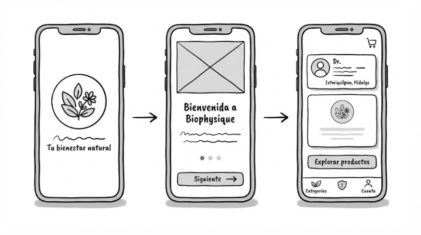
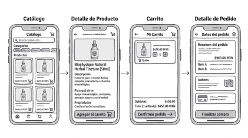
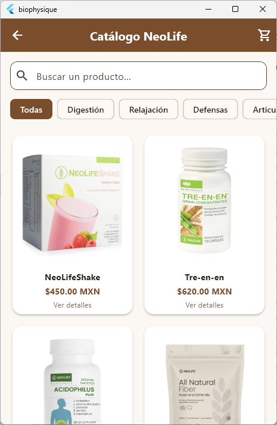
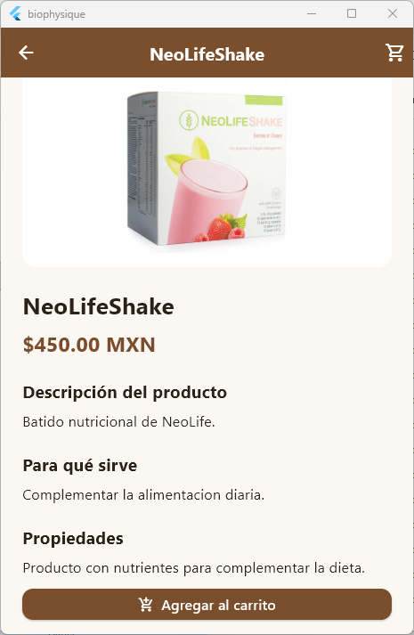
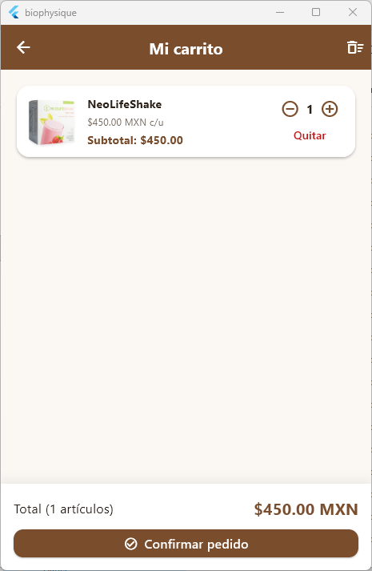
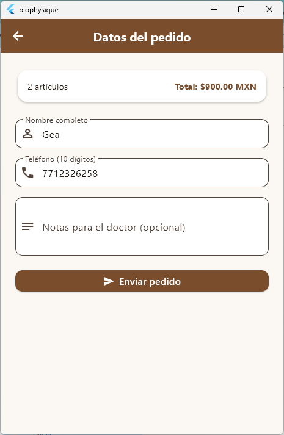
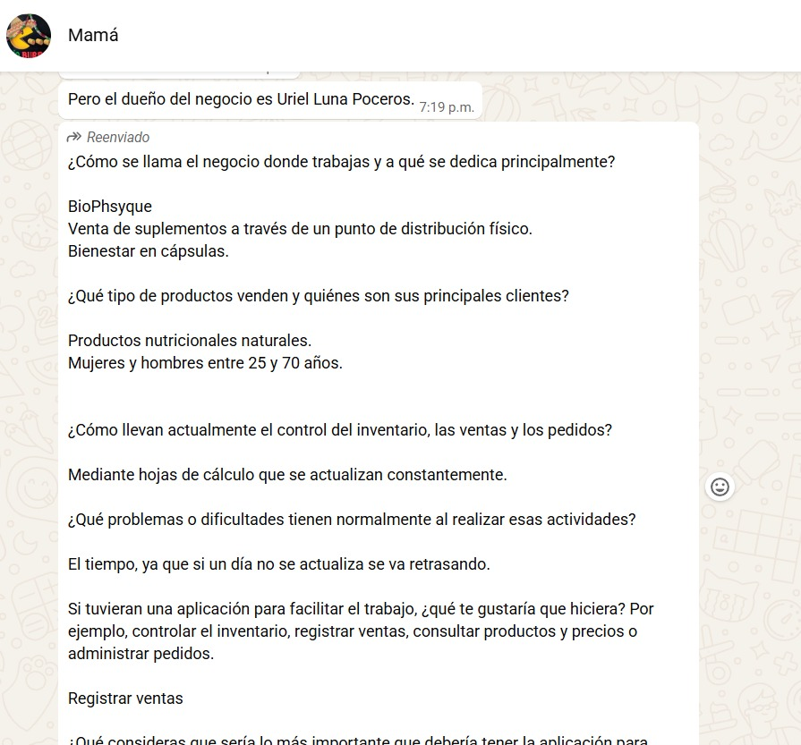
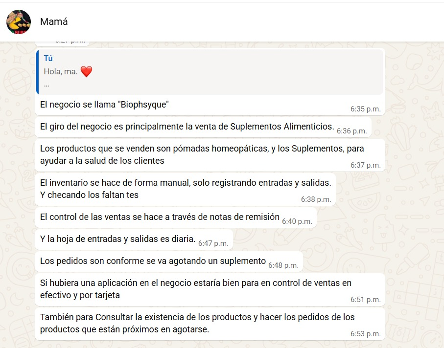

# Biophysique

Descripción
Biophysique es una aplicación móvil que se desarrollo en Flutter para los clientes de Biophysique en el cual un negocio de productos naturistas en Ixmiquilpan, Hidalgo. Permite consultar el catálogo de productos conocer para qué sirve cada uno, sus propiedades y características, y organizar la compra mediante un carrito, facilitando la selección de los productos indicados en la receta del médico homeópata.

## Cliente (Ruta A)
- **Cliente:** Biophysique, negocio dedicado a la venta de productos naturistas recomendados por un médico homeópata.
- **Ubicación:** Ixmiquilpan, Hidalgo, México.
- **Necesidad:** Actualmente el inventario y el registro de ventas se llevan de forma manual, lo que dificulta su organización. Además, los clientes no cuentan con un medio para consultar la información de los productos por su cuenta. La app ofrece un catálogo con fichas informativas de cada producto y un carrito para organizar las compras, como primer paso hacia la digitalización del negocio.

### Problema y necesidades detectadas segun las entrevistas
- Biophysique lleva inventario, ventas y pedidos de forma manual, y un solo día sin actualizar atrasa todo el registro, lo que deja al negocio sin información de ventas a la mano para decidir.
- Registrar ventas, en efectivo y por tarjeta	
- Consultar ventas por día y por semana para decidir mejor	
- Consultar la existencia de los productos	
- Hacer pedidos de productos próximos a agotarse	
- Evitar atrasos por actualizar a mano	

### Usuarios
- **Clientes:** consultan para qué sirve cada producto, sus propiedades y precios, y organizan sus compras.
- **Médico homeópata:** indica los productos que necesita cada paciente.
- **Personal del negocio:** consulta los productos y prepara los pedidos.

> **Aviso:** la información de los productos es orientativa, está basada en los datos proporcionados por el negocio y no sustituye la valoración ni las indicaciones del médico homeópata.

## Integrantes
| Nombre | Matrícula | Usuario de GitHub | Responsabilidad |
|---|---|---|---|
| Raúl Lora Lira | 233111790 | [@RobinLora](https://github.com/RobinLora) | Entrevista con el cliente; catálogo de productos y filtrado por categorías |
| Ana Karen Vera García | 233110950 | [@anavera](https://github.com/anavera) | Documentación del proyecto; desarrollo de la mayor parte de la interfaz, incluyendo la pantalla de bienvenida (splash) |
| Pedro Omar Marcelino Martínez | 233111478 | [@mtz747770-sys](https://github.com/mtz747770-sys) | Carrito de compras (agregar y eliminar productos, cálculo del total) y corrección y organización del repositorio en GitHub |

**Materia:** Programación Móvil · **Docente:** Mario Alberto Gea Pérez · **Grupo:** 9° B · **Periodo:** Septiembre–Diciembre 2026
Universidad Politécnica Metropolitana de Hidalgo, Ingeniería en Tecnologías de la Información.

## Funcionalidades de la Etapa 1
- **Pantalla de bienvenida (splash):** muestra la identidad de Biophysique al abrir la app.
- **Catálogo de productos:** listado con imagen, nombre y precio, con búsqueda por nombre y filtrado por categorías.
- **Ficha informativa del producto:** descripción, función particular, propiedades y características de cada producto.
- **Carrito de compras:** agregar y eliminar productos y calcular el total de la compra.
- **Resumen del pedido:** muestra los productos seleccionados y el total.

Los productos se almacenan localmente con datos de prueba. En esta etapa **no** se incluyen pagos reales, administración de inventario ni registro de ventas.

## Capturas
 - Boceto

|  |  |

- MVP

| Bienvenida | Catálogo | Ficha del producto |
|---|---|---|
|  |  |  |

| Carrito | Resumen del pedido |
|---|---|
|  |  |

## Instalación y ejecución

### Requisitos
- Flutter 3.47.2 (canal stable)
- Dart 3.13.2
- Android Studio o VS Code con las extensiones de Flutter y Dart
- Emulador Android o dispositivo físico

### Pasos
```bash
git clone https://github.com/[COMPLETAR]/biophysique.git
cd biophysique
flutter pub get
flutter run
```

## Estructura del proyecto
```
lib/
├── core/        # Tema visual, colores, constantes, rutas y componentes reutilizables
├── features/    # Una carpeta por funcionalidad: bienvenida, catálogo, detalle, carrito y pedido
├── models/      # Modelo de producto y de los elementos del carrito
├── data/        # Repositorio abstracto e implementación local con datos de prueba
└── main.dart    # Punto de entrada, registro de Providers y navegación
```

## Decisiones técnicas
- **Provider para el estado compartido:** se eligió por ser una solución sencilla y recomendada por Flutter para proyectos de este tamaño. El carrito se maneja en un `ChangeNotifier`, de modo que el catálogo, la ficha del producto y el resumen del pedido se actualizan automáticamente cuando se agregan o eliminan productos.
- **Repository abstracto:** las pantallas no acceden a los datos directamente, sino mediante una interfaz de repositorio. En la Etapa 1 la implementación es local y usa datos de prueba.
- **Migración a Firebase:** en la Etapa 2 se creará una nueva implementación del repositorio conectada a Firebase que cumpla la misma interfaz. Bastará con cambiar la implementación que se registra en `main.dart`, sin modificar las pantallas ni la lógica del carrito.
- **Tema y componentes reutilizables:** colores, tipografía y widgets comunes se centralizan en `core/` para mantener una apariencia uniforme y evitar código repetido.

## Backlog de la Etapa 2

### Must (indispensable)
- Integrar Firebase para almacenar los productos en la nube en lugar de los datos de prueba.
- Guardar los pedidos generados desde la app.

### Should (importante)
- Mostrar la disponibilidad de cada producto.
- Facilitar la selección de los productos indicados en una receta médica.

### Could (opcional)
- Inicio de sesión de usuarios.
- Administración del inventario por parte del personal del negocio.
- Registro de ventas.

## Fuentes externas
| Recurso | Uso en el proyecto | Enlace |
|---|---|---|
| Documentación oficial de Flutter | Estructura general, widgets y navegación | https://docs.flutter.dev |
| Paquete provider | Manejo del estado del carrito | https://pub.dev/packages/provider |

## Evidencias Entrevistas
| Medico | Trabajadora |
|---|---|
|  |  |

## Uso de IA
El detalle del uso de herramientas de inteligencia artificial durante el desarrollo (qué se pidió, para qué y cómo se verificó el resultado) se encuentra en [AI_LOG.md](AI_LOG.md).
